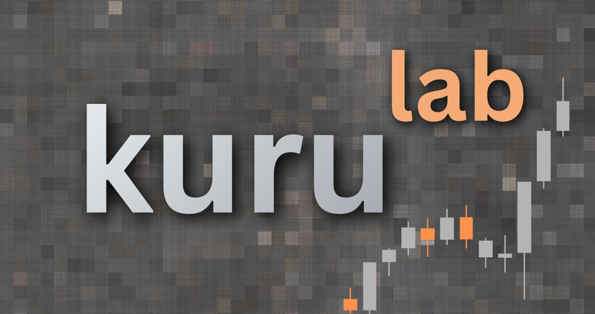

# kuruLab

Backtest a Kuru concentrated-liquidity position against locally validated Monad history. The app uses the official Kuru SDK grid, reconstructed FIFO queues, and contract flip rules. It has no wallet connection or live execution.

The supported market is MON / USDC, `0x065c9d28e428a0db40191a54d33d5b7c71a9c394`. Current continuous validated coverage is **109092028–109142027**, inclusive. Interactive backtests use local data. They do not download history.

## Setup and start

Use Python 3.11 or later and Node.js. Run these commands from this repository in WSL:

```bash
python -m venv .venv
source .venv/bin/activate
python -m pip install -e '.[dev,reports,contract-tests]'
npm ci --ignore-scripts --prefix sdk_reference
npm run build:browser --prefix sdk_reference
npm run build:charts --prefix sdk_reference
python -m kuru_backtester serve --host 127.0.0.1 --port 8000
```

Open the URL printed by the server. If Windows cannot reach the WSL localhost address, use `--host 0.0.0.0`. Open the complete access URL printed by that command. Stop the server with Ctrl+C.

The existing `python backtest_server.py` command still works. After an editable install, `kuru serve` also works. Restart a running server after code updates.

Do not restart a server while it owns a download unless you intend to stop that
download. Resume the same block range after restart to retain its saved cursor.
Changing files or pushing a Git commit does not reload a running Python server.

The base install, `python -m pip install -e .`, is sufficient for the app. The `reports` extra adds chart and Parquet libraries. The `dev` extra adds pytest. The `contract-tests` extra adds the local EVM test dependencies.

**Local history is required.** Git stores manifests, small reports, SDK fixtures, and code. It does not store the raw event files, local checkpoints, or contract bytecode cache. A new clone must prepare these files before it can run historical backtests. See [historical coverage](docs/HISTORICAL_SYSTEM.md) and [contract checks](docs/LP_CONTRACT_PARITY.md). A Trade chart alone is not backtest data.

## Set a position

The app uses one terminal grid. Drag across the main chart to select a period. Exact block fields remain available. Then set the liquidity shape, fee, range, and token amounts in the position panel. Named regimes remain regression fixtures, not UI choices.

The initial chart shows UTC dates and times. Exact block fields remain visible. Starting price is the reconstructed starting midpoint. Ending, highest, and lowest prices come from all local Trade events in the selected range, not reduced chart points. Volume is not implemented. Restart the server after updating the price-summary API.

Drag the range-center marker to move both price bounds. Drag the two lower handles to change the minimum and maximum. You can also enter prices or signed percentages. Percentages use the selected period's reconstructed starting midpoint: `−3%` is below that price; `3%` is above it. All bounds round outward to market ticks.

**Reset price** returns the range center to the period's starting midpoint. It retains the range width, subject to tick rounding. Moving the marker does not change the historical market price. The faint line shows that starting price.

Preview bars use the exact official SDK orders. Both sides use USDC notional for bar height. Red bars are below the minimum order size. Enter MON and USDC manually. The app shows each token's official SDK minimum and the amounts required by the entered grid. SDK summary minimums can need extra funds after integer rounding; exact grid and deposit checks control Run backtest. There are no amount-setting buttons.

After a run, the result metrics and replay appear beside the position controls. Simulated orders and buy/sell fills use the main chart. Strategy and hold P&L use its linked lower pane. A configuration change clears the old result. Playback does not run the engine again.

The main chart uses locally bundled TradingView Lightweight Charts 5.1.0. It shows verified partitions as they become available. Daily candles are the default; weekly, hourly, and minute candles are also available. Dates use UTC. Wheel to zoom; **All data** restores the chart range. Drag to select a period. Exact block inputs remain visible. Download, verification, candle, and LP coverage appear separately in the data panel. A verified older contract can have candles before its LP simulation is approved. The chart has no coverage color bands.

Candles come only from local Trade events. Weekly candles start on Monday at 00:00 UTC. The main chart uses `.cache/market_chart_verified/` and checks event hashes, checkpoint hashes, and passing validation reports. It follows committed verification manifests while workers run; it does not wait for the full queue. Each response has at most 1,500 candles. **Process saved data** also builds a separate broad Trade index in `.cache/market_chart/`. Unverified archive candles do not enter the main chart. Existing raw data and display caches are retained. See [terminal verification](docs/TERMINAL_UI.md).

## History and credentials

Copy `.env.example` to `.env`, then enter your Envio token in that file. Load it in the terminal that will run an indexing command:

```bash
set -a
source .env
set +a
```

The indexing CLI does not automatically read `.env`. The Data suite reads `ENVIO_API_TOKEN` and `MONAD_RPC_URL` from the local `.env` without executing shell commands. Existing server environment values take priority. Git ignores `.env` and its private variants. Envio credentials are needed for downloads, not local backtests or replay playback.

Open **Data suite** from the app, or `/indexing.html`. Check the finalized block, select a bounded range, and confirm the network download. Use **Download + verify**. One panel controls both tasks. The page shows coverage and saved data size. It never starts work on page load. See [Data suite controls](docs/FULL_HISTORY.md#data-suite-controls).

Verification first checks completed local L3 data. At the same time, HyperSync
downloads missing data in the selected range. Verification then checks newly
completed partitions and runs one final check after downloading stops.
Incomplete partitions and Trade-only caches are not eligible. Saved hashes
are checked before verified data is skipped. **Stop** stops both server-owned
workers. An error also stops both tasks. Start again to resume saved cursors
and checks. Passing partitions from the tested LP implementation receive
additional rule and checkpoint checks before entering the LP index. Unsupported
vault partitions remain gaps. The queue records them and checks later partitions.
Other reconstructed runtimes remain unavailable for LP simulation.

Each page shows a loading screen until its initial local data is available. The Data suite waits for coverage, saved storage totals, and process status. Partial historical coverage is allowed. The last completed inventory is saved locally for fast server startup; its check time remains visible while a fresh scan runs. Download coverage also updates from committed worker progress on each status request.

Backtests can be loaded from **Previous backtests**. Only completed local runs
with valid saved hashes are available. Loading restores the saved configuration,
metrics, and replay; it does not run the engine. Results stay hidden until a run
is complete or loaded. Editing a setting clears the result. Replay uses the
original cached Canvas price and portfolio-value charts. TradingView is used
only for the market history chart. Weekly history candles use weekly gaps,
not empty daily slots between each candle.

Replay now shows best bid and ask only, with fill dots at their recorded time
and execution price. A one-minute Sharpe estimate is shown when at least 30
returns are available. It uses compact replay marks, zero risk-free rate, and
no annualization; it is not an exact full-event statistic.
**Process saved data** runs archive-RPC verification and local Trade candle
indexing without an Envio download. Queue progress includes completed child
partitions before the entire range finishes. See [terminal details](docs/TERMINAL_UI.md).

The latest bounded checks, readiness results, and measured delays are recorded
in [the reconstruction debug report](docs/RECONSTRUCTION_DEBUG_REPORT.md).

Job titles are bold. Active status labels have animated dots. Progress bars use
known block, partition, or event totals. Unknown totals use an animated bar,
not a made-up percentage. Coverage updates from committed worker progress;
storage totals still use the background inventory scan. The preparation block
range is under a closed details menu. Its default is the entire history from
deployment through the checked finalized block. No work starts on page load.
The wallet pill is a non-interactive preview. No wallet or execution support is
enabled.

Each current job has a status banner. **Jobs** in the header opens saved job
history. The floating activity log contains technical events, not the job list.
HyperSync entries report requests, responses, saved cursors, duplicates, and
rate limits. Verification entries report archive RPC method counts and waits,
event and timestamp parity, L2 checks, full L3 queue comparisons, cancellation
audits, content hashes, candle publication, and LP eligibility. Old workers still
provide their existing counters; the new RPC trace starts with a new worker.

Storage totals use one background scan, at most once per minute after the last
scan finishes. Status requests do not wait for that scan. Unknown totals show
`—`; failed refreshes retain the last totals. The page can remain open while
idle without repeatedly blocking progress requests on a full file scan.

To inspect a full-history download plan without network calls:

```bash
python -m kuru_backtester history --to-finalized --download-only \
  --job-root .cache/full_history_archive
```

Adding `--execute` starts the download. Use the same command to resume it. Read [the full-history guide](docs/FULL_HISTORY.md) first. The deployment and intermediate runtimes now have [bounded reconstruction tests](docs/LEGACY_RECONSTRUCTION.md). The correction also covers the unsupported-version error at block 69,999,999. Full lifetime coverage is not yet verified. Download completion does not establish validated L3 coverage.

To display progress for that job:

```bash
python -m kuru_backtester monitor \
  --job-root .cache/full_history_archive --port 8002
```

The compatibility commands `python full_history.py` and `python full_history_monitor.py` still work.

## Project layout

```text
kuru_backtester/
  engine/         Verified queues, reconstruction, LP rules, and accounting
  history/        Download, coverage, checkpoints, validation, and promotion
  server/         HTTP API, job workers, SDK broker, and progress monitor
  tools/          Regression checks, benchmarks, chart export, contract checks
  legacy/         Early tools kept for regression and data reproduction
  compact_replays.py
frontend/         Current LP app and indexing monitor
sdk_reference/    Pinned official SDK adapter, fixtures, and browser tests
tests/            Python tests and small fixtures
data/reports/     Small recorded discovery and golden-regression reports
docs/             Current guides; old reports are in docs/archive/
```

The two manifests stay at the root. Their data paths are relative to the root. Local `.cache/`, `validation_output/`, `strategy_output/`, `lp_output/`, and `multi_regime_output/` paths stay in place so existing results and jobs remain usable. Large old demo replays now live under `tests/fixtures/legacy_replays/` and are ignored. The app does not serve or load them.

## Commands and checks

```bash
python -m kuru_backtester --help
python -m kuru_backtester index --help
python -m kuru_backtester validate --help
python -m kuru_backtester promote --help
python -m pytest -q
npm run test:adapter --prefix sdk_reference
```

With the validated local data installed, run all three LP golden comparisons:

```bash
python -m kuru_backtester regression
```

This writes `data/reports/lp_contract_regression_report.json`. Use the benchmark command with a bounded event prefix to measure a change:

```bash
python -m kuru_backtester benchmark --event-limit 10000 --product-mode
```

The full test suite uses the local validated history and contract cache. Two extra tests check archived demo replays when those optional local files exist. They skip on a clone without those large files. Core grid, queue, accounting, and request tests do not depend on demo replays.

Latest complete local check, **2026-10-11**: **270 tests and 12 subtests passed**.
The data-suite status requests took **15–22 ms** while a storage scan ran;
progress requests took **7–8 ms**. These are local measurements, not hosting
capacity guarantees. See the [status performance report](docs/FULL_HISTORY.md#status-performance-correction--2026-10-11).

## Documentation

The Data page can now reconstruct and verify completed download partitions.
Verification uses archive RPC, not Envio, and writes separate output files.
It can run while later partitions download. Unsupported contract versions still
stop the job. See [verification controls and commands](docs/FULL_HISTORY.md#verify-completed-downloads-while-other-data-downloads).
Do not restart a server that owns an active download to load the new controls;
use a second server on an unused port or the CLI.

- [Architecture and module guide](docs/ARCHITECTURE.md)
- [Form, job, engine, and replay path](docs/BACKTEST_REQUEST_PATH.md)
- [Local historical coverage and validation](docs/HISTORICAL_SYSTEM.md)
- [Full-history download and monitor](docs/FULL_HISTORY.md)
- [Official SDK reference](docs/SDK_REFERENCE.md)
- [LP contract behavior and limits](docs/LP_CONTRACT_PARITY.md)
- [Cleanup results and remaining work](docs/MAINTENANCE.md)
- [Post-push code review: bugs and speed work](docs/reviews/2026-10-11_REVIEW.md)
- [Hosting and hackathon submission plan](docs/plans/HOSTING_AND_SUBMISSION.md)
- [Wallet and LP execution plan](docs/plans/WALLET_EXECUTION.md)

Historical results do not prove future fills or profit. Simulated orders do not change later historical taker behavior. The app reports transaction impact. Gas costs are excluded. See the contract guide for the exact tested scope.
